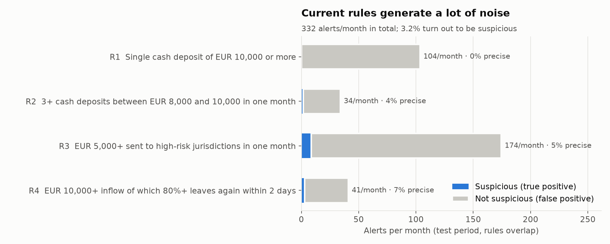
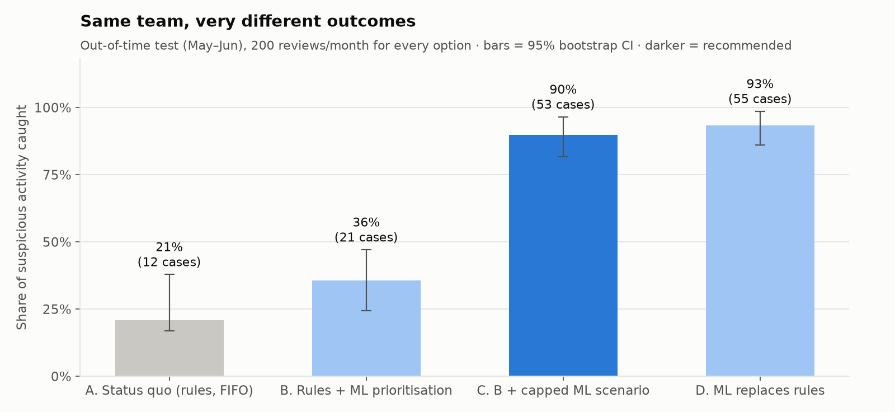
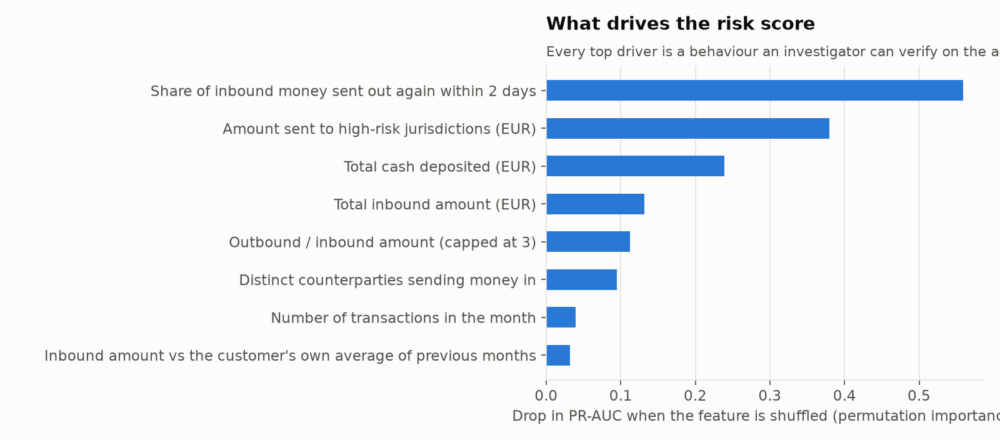
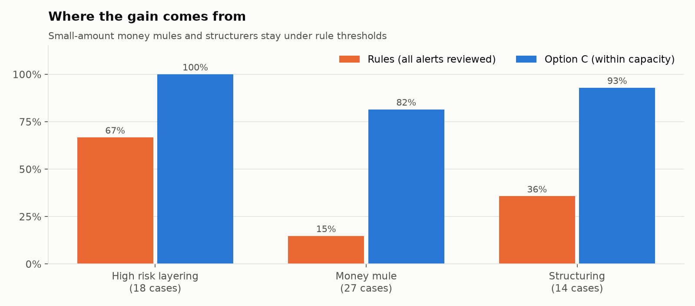
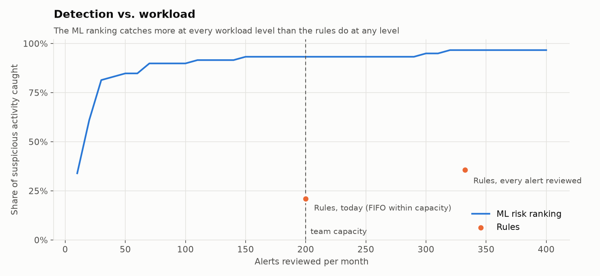
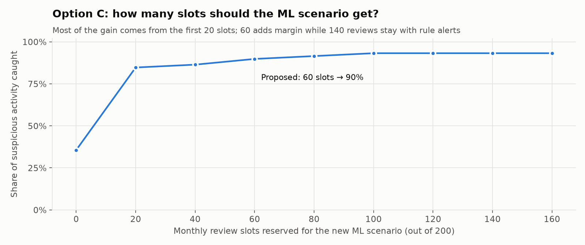

# From noisy rule alerts to a decision-ready model change
### An anti-money-laundering (AML) transaction-monitoring case study, seen through the eyes of an analytics translator

[](tests/)  

Most portfolio projects end at *"my model has an AUC of 0.99"*. In a bank, that is where the real work starts: **What problem are we solving? What changes for investigators? What could go wrong? Who has to decide, and on what evidence?**

This project takes a realistic transaction-monitoring problem and works it end to end: from framing the question, to building and validating the analytics, to a **decision proposal, release sign-off checklist, findings log and handover** that a product owner, Compliance and Model Risk could act on.

---

## The problem in one paragraph

A bank's monitoring rules produce **~333 alerts a month** for a team that can review **200**. Only **3.2%** of rule alerts turn out to be suspicious. And even if every alert were reviewed, the rules would find only **36%** of the suspicious activity, because money mules and structurers keep each transaction small enough to stay under every threshold.



**The key reframing:** this is *two* problems. A **capacity problem** (which alerts get reviewed?) and a **detection problem** (what do the rules never see?). Hiring more investigators fixes only the first.

## The result

Four options, all evaluated at the **same capacity (200 reviews/month, 150 investigator-hours)** on months the model never saw:



| Option | Suspicious cases caught (of 59) | Detection | Recommended? |
|---|---|---|---|
| A. Status quo: rules, first-in-first-out | 12 | 21% | |
| B. Same rule alerts, sorted by ML risk score | 21 | 36% | ✅ Phase 1: quick, low-risk |
| **C. B + 60 monthly slots for a new ML scenario** | **53** | **90%** | ✅ **Phase 2, after a parallel run** |
| D. Replace rules with ML entirely | 55 | 93% | ❌ Not now (see below) |

**Why C and not D, when D scores higher?** The difference is 2 cases, well within the uncertainty band. In exchange, C keeps the rules as a transparent safety net, is easier to validate and defend to auditors, and can be rolled back with one config value. That trade-off is the core of the [decision proposal](docs/03_decision_proposal.md).

## Translator deliverables

| Document | What it shows |
|---|---|
| [01 · Problem framing](docs/01_problem_framing.md) | Splitting a vague problem into capacity vs detection; KPIs agreed *before* modelling |
| [02 · Requirements](docs/02_requirements.md) | Functional & non-functional requirements with acceptance criteria linked to tests |
| [03 · Decision proposal](docs/03_decision_proposal.md) ⭐ | Four options, trade-offs, phased plan, risks, decisions requested from named owners |
| [04 · Release sign-off checklist](docs/04_release_signoff_checklist.md) | Go/no-go across business, model, technical and documentation checks |
| [05 · Findings log](docs/05_findings_log.md) | Issues found during development, with severity, owner, action and status |
| [06 · Stakeholders & RACI](docs/06_stakeholders_raci.md) | Who needs what, and who decides what |
| [07 · BAU handover](docs/07_bau_handover.md) | Owners, monitoring thresholds, rollback triggers, recurring rhythm |

## What drives the ML score, and how investigators see it



Every feature is a behaviour an investigator can check on the account. Each ML alert comes with **three reason codes using real values**, for example:

> *Inbound amount vs the customer's own average of previous months = 3.6x (top 2%); Share of inbound money sent out again within 2 days = 73% (top 3%); Amount sent to high-risk jurisdictions = EUR 2,316 (top 6%)*

See [`reports/sample_ml_alerts_with_reason_codes.csv`](reports/sample_ml_alerts_with_reason_codes.csv).

## Where the gain comes from



Rules catch only **15%** of money-mule activity. The model catches it through *behaviour*: money forwarded within two days, many distinct senders, and a sudden jump versus the customer's own history.

<details>
<summary><b>More charts: detection vs workload, and sizing the ML scenario</b></summary>



</details>

---

## How it works

```
generate_data.py   5,000 synthetic customers · 736k transactions · 6 months
       │           incl. legitimate look-alikes (cash businesses, remitters,
       │           savings sweepers, import/export SMEs, marketplace sellers)
       ▼
features.py        30,000 customer-months · 18 explainable features
       │           (no look-ahead: behavioural baseline uses previous months only)
       ▼
rules.py           R1–R4: the "current production" scenarios
       ▼
model.py           Gradient boosting (+ logistic regression benchmark)
       │           out-of-time split: train Jan–Apr, validate May–Jun
       ▼
options.py         Options A–D at fixed capacity · bootstrap CIs · capacity curve
       ▼
reports/           results.json · 6 figures · sample alerts with reason codes
```

### Run it

```bash
git clone https://github.com/mfakgun97/aml-transaction-monitoring-case-study.git
cd aml-transaction-monitoring-case-study
pip install -e ".[dev]"

python -m aml_tm.pipeline   # generates data, runs everything, writes reports/ (~30 s)
pytest                      # 15 tests: rule boundaries, no look-ahead, capacity caps, reproducibility
```

All business parameters (rule thresholds, capacity, ML slots) are in [`src/aml_tm/config.py`](src/aml_tm/config.py), so any change request is a single, reviewable diff.

## Methodology choices worth noting

- **The decision metric is detection within capacity**, not AUC. Model metrics (gradient boosting PR-AUC 0.84 vs logistic regression 0.61) are reported, but options are compared on what the business can actually do with 200 reviews.
- **Out-of-time validation.** A random split would let the model learn from the "future" and overstate performance.
- **Uncertainty is reported.** There are only 59 suspicious customer-months in validation, so every headline number has a 95% bootstrap confidence interval (resampling customers).
- **Findings are logged, not hidden.** The first model scored a suspicious PR-AUC of 0.98. The cause (synthetic data without enough legitimate look-alikes) is documented and fixed in [F-01](docs/05_findings_log.md).

## Honest limitations

- **The data is synthetic.** Real transaction data is never public. I generated it so that the ground truth is known and the legitimate behaviour that makes AML noisy is included on purpose. Absolute numbers on real data will be lower; the **method, trade-offs and decision structure** are what transfer.
- High-risk jurisdiction codes (`XA`–`XD`) are deliberately fictional; in practice they come from FATF lists and internal country-risk models.
- Ground truth means "would have led to an unusual-transaction report"; real labels are noisier and arrive with a delay.

## Project structure

```
├── src/aml_tm/          config · generate_data · features · rules · model · options · plots · pipeline
├── tests/               rule boundaries, feature logic, capacity constraints, reproducibility
├── docs/                01–07 translator deliverables
├── reports/             results.json · options_comparison.csv · sample alerts · figures/
└── data/                generated on first run (git-ignored)
```

---

**Author:** Meryem Fulya Akgün · MSc Data Science & Society (Tilburg University / JADS) · Data Quality Analyst in asset management · background in derivatives operations
[GitHub](https://github.com/mfakgun97)
