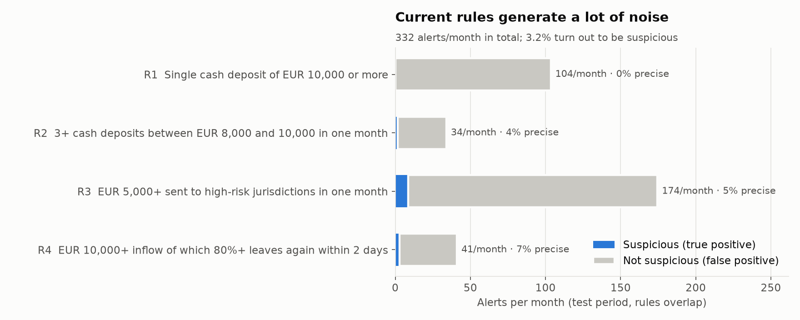

# 01 · Problem framing

> **One-line problem statement**
> Our transaction-monitoring (TM) rules produce more alerts than the investigation team can review, most of those alerts are false positives, and the suspicious activity the rules *do* miss is concentrated in small-amount money mules and structurers.

## 1. Why this matters

Under the Dutch AML/CFT act (Wwft), banks must monitor transactions and report unusual ones to FIU-Nederland. Two failure modes are costly:

| Failure mode | Consequence |
|---|---|
| **Missed suspicious activity** (false negatives) | Criminal money moves through the bank; regulatory and reputational risk |
| **Too many false positives** | Investigator time wasted, growing backlog, slower handling of the real cases, customer friction |

## 2. Current situation (baseline, test period May–Jun)

| Fact | Value | Source |
|---|---|---|
| Rule alerts generated | **~333 / month** | `reports/results.json` |
| Investigator capacity | **200 alerts / month** (assumption) | `config.py` |
| Rule alerts that are suspicious (precision) | **3.2%** | `results.json` |
| Suspicious activity caught *if every rule alert were reviewed* | **36%** | `results.json` |
| Suspicious activity caught *today* (FIFO within capacity) | **21%** | option A |
| Rule R1 (cash ≥ €10k) true positives | **0** out of ~104 alerts/month | `results.json` |

**Reading the baseline as a translator:** this is two problems, not one.

1. **A capacity problem.** ~133 alerts a month never reach an investigator, and nothing decides *which* ones are left behind.
2. **A detection problem.** Even with unlimited capacity, the rules only find about a third of suspicious activity. More people would not fix this.

Splitting the problem this way changes what we ask the data science team for: not just "a better model" but (a) a way to rank the existing alerts and (b) a way to find what no rule covers.

## 3. Business question for the model team

> *With the investigators we have, can a risk score (1) put the right rule alerts first and (2) add a small, controlled number of new alerts for behaviour the rules miss, without weakening the coverage the rules provide today?*

## 4. Success measures (agreed before building)

| KPI | Definition | Why |
|---|---|---|
| **Detection within capacity** | Share of suspicious customer-months reviewed within 200 alerts/month | The outcome the business actually cares about |
| **Alert precision** | Share of reviewed alerts that are suspicious | Investigator efficiency |
| **Rule coverage retained** | Suspicious cases caught by rules that are *still* caught | Guard against silently losing known typologies |
| **Explainability** | Every ML alert carries 3 readable reason codes | Investigators and auditors must understand *why* |

AUC and PR-AUC are reported for the model team, but **they are not the decision metric**.

## 5. Scope

**In scope:** customer-month alert generation and prioritisation for retail and SME customers; four existing rules (R1–R4); one ML risk score.

**Out of scope (and why):**
- *Sanctions screening and name matching*: a different process with a different legal basis.
- *Case management tooling*: we assume alerts land in the existing tool, sorted by a new field.
- *Re-tuning rule thresholds*: valuable, but a separate change with its own sign-off; noted as a follow-up in the findings log.

## 6. Key assumptions to validate with stakeholders

| # | Assumption | Validate with |
|---|---|---|
| A1 | Capacity is 200 alerts/month at 45 min each | Investigations team lead |
| A2 | Ground truth = "would have led to an unusual-transaction report" | AML subject-matter expert |
| A3 | A customer-month is the right alert unit | Investigations + Compliance |
| A4 | Lower-ranked rule alerts may get lighter handling *after* evidence from a parallel run | Compliance / 2nd line |
