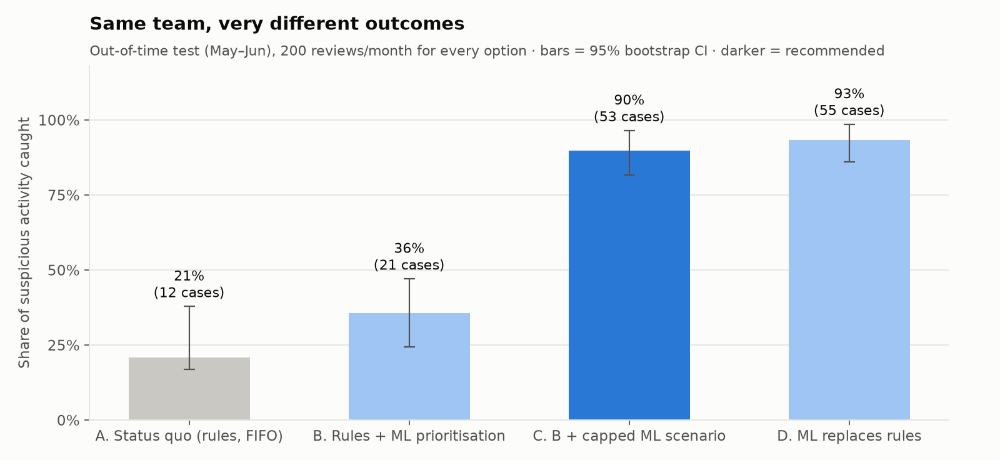
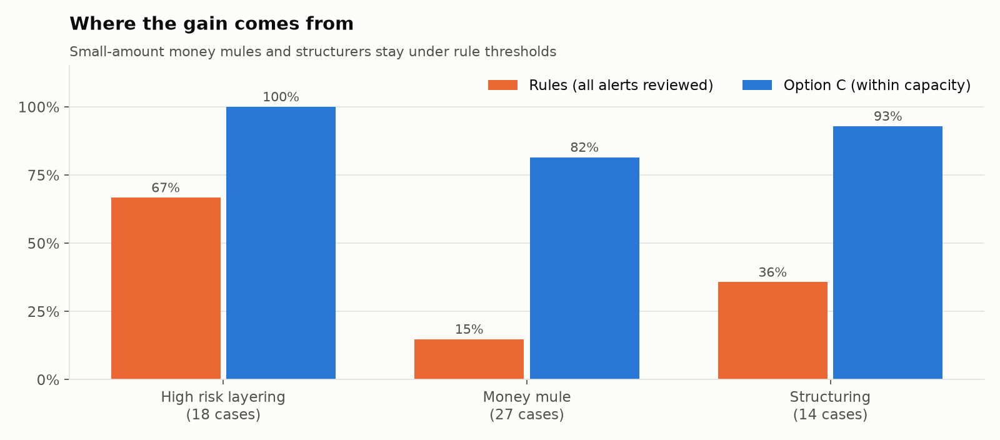
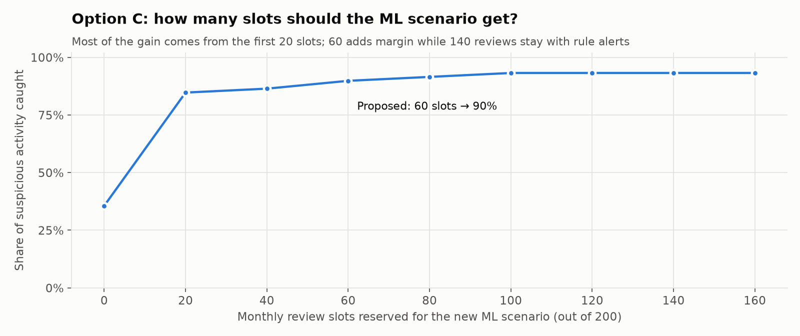

# 03 · Decision proposal: ML-assisted alert prioritisation and a capped ML scenario

| | |

| **Status** | For decision |

## 1. Summary (the 30-second version)

The current rules generate ~333 alerts a month for a team that can review 200. Only 3.2% of rule alerts are suspicious, and even if every alert were reviewed, the rules would find only 36% of suspicious activity.

**Recommendation: Option C, in two phases.**
Keep all rules. Use an ML risk score to (1) put the riskiest rule alerts first and (2) reserve 60 of the 200 monthly reviews for a new ML scenario. On out-of-time validation this raises detection **from 21% to 90%** with the **same team and the same 150 investigator-hours a month**.

## 2. Options considered

All options are evaluated at the same capacity (200 reviews/month), on months the model never saw (May–Jun).

| Option | What changes | Caught (of 59) | Detection | Precision of reviewed | Main risk |
|---|---|---|---|---|---|
| **A. Status quo** | Nothing; alerts worked first-in-first-out | 12 | 21% (CI 17–38%) | 3.1% | Backlog keeps growing; the riskiest alerts may sit unreviewed |
| **B. Prioritise** | Same rule alerts, sorted by ML score | 21 | 36% (CI 24–47%) | 5.2% | Low: ordering only, no new detection logic. **But capped at what rules can find** |
| **C. Prioritise + capped ML scenario** ⭐ | B + 60 ML-only alerts/month | 53 | **90%** (CI 82–97%) | 13.3% | ML scenario needs model validation; 140 rule-alert slots instead of 200 |
| **D. Replace rules with ML** | Rules switched off; top 200 by ML score | 55 | 93% (CI 86–99%) | 13.8% | High: loses transparent, regulator-familiar coverage; single point of failure |

### Why not D, if it scores highest?
- **The gain over C is 2 cases, within the uncertainty band.** The confidence intervals overlap heavily.
- **Rules are the safety net.** If the model degrades (drift, data-feed issue), C still has rule coverage. D does not.
- **Explainability and regulatory comfort.** Rules are easy to defend to auditors today. D requires a far larger validation and approval effort.
- **Reversibility.** C can be rolled back by setting the ML slots to 0 in one config value. D cannot be rolled back as easily.

### Why not stop at B?
B is a quick, low-risk win (21 vs 12 cases), but it **cannot exceed what the rules detect (36%)**. The bigger problem is a detection gap, not an ordering gap:

Money mules are where rules fail most (15% found), because individual amounts stay under every threshold. The ML score picks them up through *behaviour*: money forwarded within two days, many distinct senders, a sudden jump versus the customer's own history.

## 3. How big should the ML scenario be?

Most of the gain comes from the first 20 slots (36% to 85%). We propose **60** (30% of capacity) as a balance: it adds margin for model error and drift, while the 140 highest-scoring rule alerts are still fully reviewed. This number lives in `config.py` (`ML_SCENARIO_SLOTS`), so it can be tuned at each release.

## 4. What happens to lower-ranked rule alerts?

Under option C, ~193 rule alerts a month are not in the full-review queue. **They must not simply disappear.** In the validation period none of them were suspicious, but with only 59 positive cases that is evidence, not proof.

Proposal: route them to a **lighter-handling lane** (short checklist review) with a **random QA sample** given full review. If the QA sample finds suspicious cases above an agreed tolerance, slots move back to rule alerts.

## 5. Decisions requested

| # | Decision | Recommended | Owner |
|---|---|---|---|
| **D-1** | Approve Phase 1: ML prioritisation of rule alerts (option B) | Approve | Product owner + Investigations |
| **D-2** | Approve Phase 2: capped ML scenario of 60 alerts/month (option C), **after** a 3-month parallel run | Approve in principle | Compliance + Model Risk |
| **D-3** | Approve the lighter-handling lane with a ≥ 10% QA sample for lower-ranked rule alerts | Approve, pending QA design | Compliance |
| **D-4** | Agree the success criteria for the parallel run (below) | Approve | All |

## 6. Phased plan

| Phase | Duration | What | Exit criterion |
|---|---|---|---|
| **0. Validation** | 4–6 weeks | Independent model validation; close findings F-01..F-03 (see findings log) | No open high-severity findings |
| **1. Prioritise (B)** | 1 release | Sort rule queue by score; no change to alert generation | Investigators confirm queue is usable; no rule output change (FR-1) |
| **2. Parallel run (C, shadow)** | 3 months | ML scenario runs in shadow mode; a sample of ML alerts is reviewed | ML-scenario precision ≥ 3× rule precision; QA sample of lighter lane within tolerance |
| **3. Go-live (C)** | 1 release | 60 ML slots live, lighter lane live | Release sign-off checklist complete |
| **4. BAU** | Ongoing | Monthly monitoring, quarterly retraining review | See handover document |

## 7. Risks and mitigations

| Risk | Likelihood | Impact | Mitigation |
|---|---|---|---|
| Model trained on only ~100 positives over-fits | Medium | High | Out-of-time validation; CI reported; parallel run before go-live |
| Criminal behaviour shifts (drift) | High over time | Medium | Monthly drift monitoring; rules remain as safety net; slots can drop to 0 |
| Investigators distrust ML alerts | Medium | Medium | Reason codes with real values; involve investigators in UAT; feedback loop |
| Lighter lane misses true cases | Low–Medium | High | QA sampling with an agreed tolerance and automatic rollback trigger |
| Synthetic data in this case study flatters the model | **Certain** | n/a | Real-data performance will be lower; the **method and decision structure** is the deliverable |

## 8. What this proposal does *not* claim
- The exact percentages come from **synthetic data** built for this case study. In a real setting the absolute numbers will be lower; the *relative* comparison and the decision structure are what transfer.
- Detection here means "reviewed by an investigator". Whether that leads to a report to FIU-Nederland still depends on the investigation.
